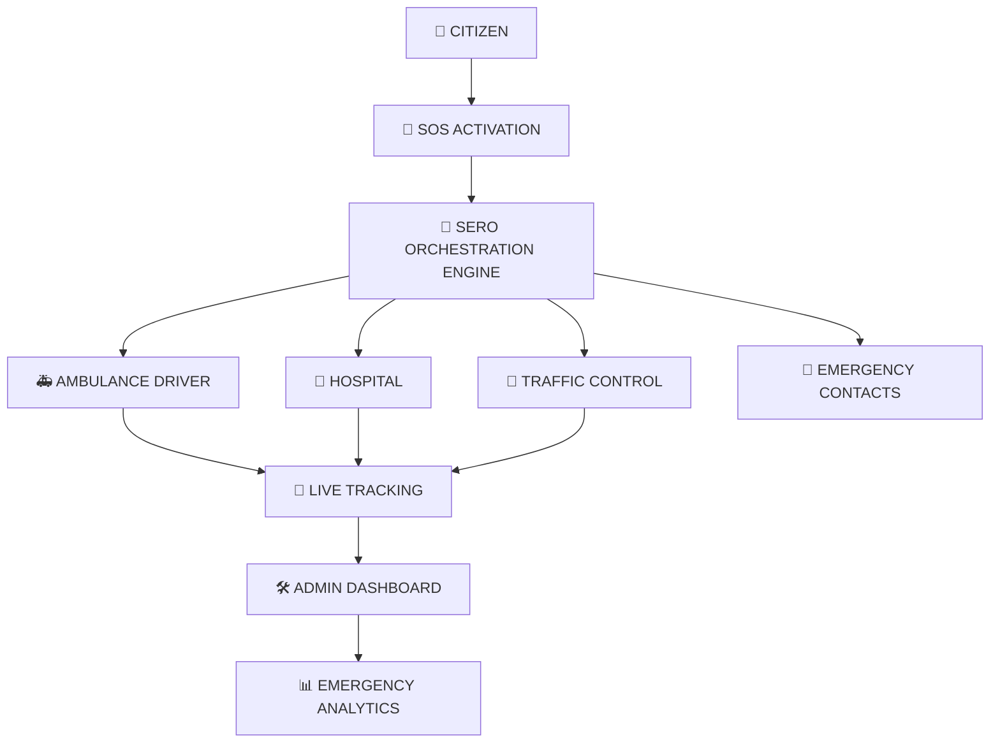
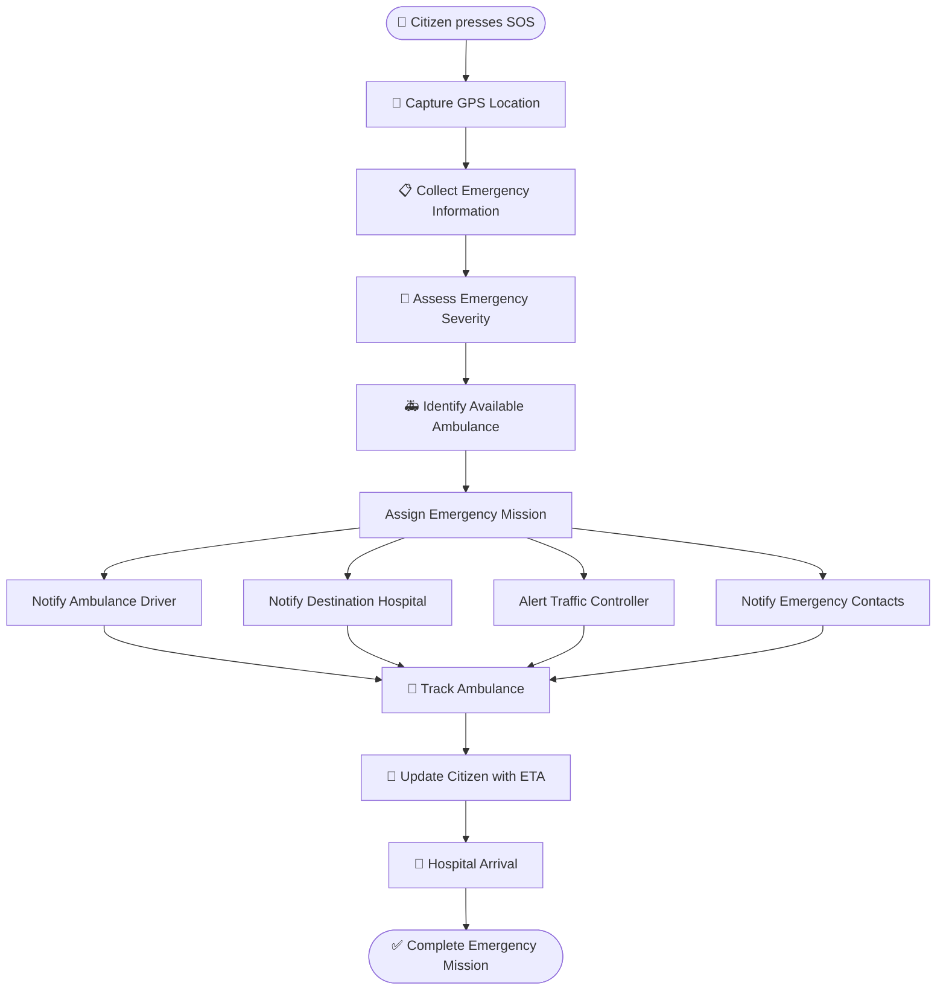
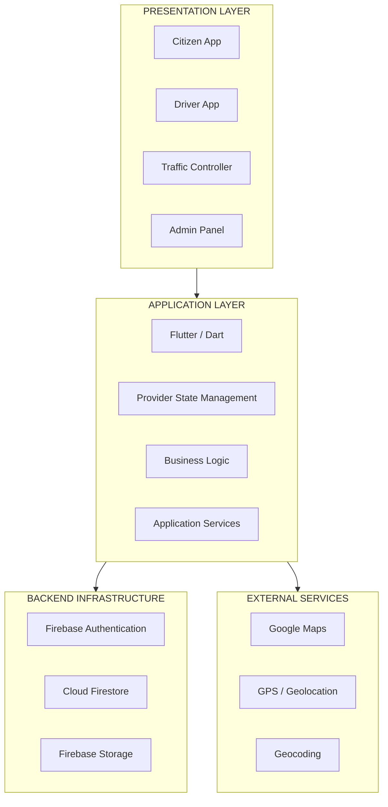

# 🚑 SERO
### Smart Emergency Response Orchestrator

<p align="center">
  
  
  
  
</p>

<p align="center">
  <b>ONE SOS. ONE INTELLIGENT NETWORK. FASTER EMERGENCY RESPONSE.</b>
</p>

<p align="center">
  An AI-assisted, multi-stakeholder emergency response ecosystem designed to connect citizens, ambulance drivers, hospitals, traffic authorities, and administrators through one unified digital platform.
</p>

---

## ◈ 01 — THE VISION

> **When every second matters, coordination becomes the difference.**

SERO (Smart Emergency Response Orchestrator) is a next-generation emergency response platform designed to transform fragmented emergency services into a unified, intelligent, and coordinated ecosystem.

Traditional emergency systems often operate in isolation. Citizens contact emergency services, ambulances navigate through traffic, hospitals prepare independently, and authorities receive limited information.

SERO introduces a coordinated emergency workflow that connects all these stakeholders through a single emergency orchestration layer.

From SOS activation to ambulance assignment, hospital notification, and live tracking, SERO aims to streamline the entire emergency response lifecycle.

<p align="center">
  <b>INTELLIGENCE × COORDINATION × REAL-TIME COMMUNICATION</b>
</p>

---

## ◈ 02 — THE PROBLEM SPACE

### The Emergency Coordination Gap

| Challenge | Conventional limitation | SERO approach |
|---|---|---|
| Ambulance Allocation | Manual coordination | Intelligent allocation architecture |
| Location Detection | Location sharing delays | GPS-based location detection |
| Hospital Coordination | Separate communication | Hospital notification workflow |
| Traffic Management | Limited coordination | Traffic authority alerts |
| Patient Visibility | Limited tracking | Live ambulance tracking |
| Emergency Contacts | Manual notification | Automated notification architecture |

### Why It Matters

- Delayed ambulance dispatch.
- Fragmented emergency communication.
- Lack of centralized incident monitoring.
- Inefficient coordination between emergency stakeholders.
- Limited visibility into emergency progress.

SERO aims to address these challenges through a unified emergency orchestration architecture.

---

## ◈ 03 — THE SERO ECOSYSTEM

### One Platform. Four Operational Layers.

| Layer | Primary Responsibility |
|---|---|
| 🧑 Citizen | Initiates emergency requests and tracks assistance |
| 🚑 Ambulance Driver | Receives and manages emergency assignments |
| 🚦 Traffic Controller | Monitors emergency movement and coordinates clearance |
| 🛠️ Administrator | Oversees users, drivers, emergencies and analytics |

### The Connected Ecosystem



---

## ◈ 04 — INTELLIGENT EMERGENCY LIFECYCLE

### From Emergency Detection to Hospital Arrival

The SERO emergency lifecycle is designed around a coordinated, event-driven workflow.



### Operational Intelligence

- Location-aware emergency initiation.
- Emergency severity assessment architecture.
- Ambulance allocation workflow.
- Multi-stakeholder notifications.
- Real-time tracking architecture.
- Emergency mission lifecycle management.

---

## ◈ 05 — CORE PLATFORM MODULES

### 🧑 CITIZEN EXPERIENCE

The primary interface for initiating and monitoring emergency assistance.

**Capabilities**

- Secure Authentication
- Smart SOS Activation
- Emergency Type Selection
- Live GPS Detection
- Reverse Geocoding
- Medical Profile Management
- AI Severity Prediction — architecture ready
- Live Ambulance Tracking
- Assigned Hospital Details
- Real-Time ETA Updates
- Emergency Contact Notifications

### 🚑 AMBULANCE DRIVER CONSOLE

A mission-oriented interface for emergency transportation management.

**Capabilities**

- Real-Time Emergency Requests
- Assigned Patient Information
- Emergency Mission Dashboard
- Navigation Support
- Live Status Updates
- Mission Completion Workflow

### 🚦 TRAFFIC CONTROL CONSOLE

A coordination layer designed to support emergency transportation.

**Capabilities**

- Active Emergency Dashboard
- Ambulance Route Monitoring
- Emergency Corridor Support
- Incident Monitoring
- Traffic Clearance Coordination

### 🛠️ ADMINISTRATOR CONSOLE

A centralized operational management interface.

**Capabilities**

- User Management
- Driver Management
- Emergency Monitoring
- Analytics Dashboard
- System Overview
- Platform Insights

---

## ◈ 06 — SYSTEM ARCHITECTURE

### Multi-Layer Application Architecture



### Architecture Philosophy

SERO follows a modular application architecture that separates presentation, business logic, services, data management, and external integrations.

This separation supports:

- Maintainability.
- Reusable components.
- Independent module development.
- Scalable feature expansion.
- Easier integration of intelligent services.

---

## ◈ 07 — TECHNOLOGY MATRIX

| Technology | Purpose |
|---|---|
| Flutter | Cross-platform application development |
| Dart | Application programming language |
| Firebase Authentication | User authentication |
| Cloud Firestore | Cloud database |
| Firebase Storage | File storage |
| Google Maps | Map visualization |
| Geolocator | GPS location detection |
| Geocoding | Coordinate and address conversion |
| Provider | State management |

### Development Stack

<p align="center">
  
</p>

### Planned Integrations

- Firebase Cloud Messaging
- Firebase Analytics
- AI-based emergency severity prediction
- Intelligent ambulance allocation
- Hospital availability integration
- Smart traffic coordination

---

## ◈ 08 — DATABASE ARCHITECTURE

### Cloud Firestore Collection Design

```text
FIRESTORE DATABASE
│
├── users/
│   ├── userId
│   ├── name
│   ├── email
│   └── medicalProfile
│
├── drivers/
│   ├── driverId
│   ├── availability
│   └── currentLocation
│
├── traffic_controllers/
│   ├── controllerId
│   └── assignedZone
│
├── emergencies/
│   ├── emergencyId
│   ├── userId
│   ├── location
│   ├── severity
│   ├── assignedDriver
│   ├── hospital
│   ├── status
│   └── timestamp
│
└── emergency_alerts/
    ├── alertId
    ├── emergencyId
    ├── recipientId
    └── notificationStatus
```

*This represents the documented collection design, not a guarantee that every field or collection is already implemented.*

---

## ◈ 09 — REAL-TIME LOCATION INTELLIGENCE

Location awareness is a central part of SERO's emergency coordination architecture.

### Location Processing Pipeline


### Location Capabilities

- Current GPS location detection.
- Coordinate-to-address conversion.
- Map-based location visualization.
- Ambulance movement monitoring.
- Emergency route awareness.

---

## ◈ 10 — SECURITY & RELIABILITY

Emergency-related applications require careful attention to privacy, reliability, and access control.

SERO's security direction includes:

- Firebase Authentication.
- Role-based access design.
- Secure handling of user information.
- Controlled access to emergency records.
- Protected backend configuration.
- Appropriate Firestore security rules.
- Careful management of location permissions.

**Production consideration:** Emergency dispatch, automated alerts, and medical response must be independently validated before real-world deployment. SERO should not be treated as a replacement for official emergency services.

---

## ◈ 11 — PROJECT STRUCTURE

```text
SERO/
│
├── android/
├── ios/
├── linux/
├── macos/
├── web/
├── windows/
│
├── lib/
│   │
│   ├── core/
│   │   ├── constants.dart
│   │   └── themes.dart
│   │
│   ├── models/
│   │
│   ├── screens/
│   │   ├── auth/
│   │   ├── citizen/
│   │   ├── driver/
│   │   ├── traffic_controller/
│   │   └── admin/
│   │
│   ├── services/
│   │   ├── auth_service.dart
│   │   ├── firestore_service.dart
│   │   └── location_service.dart
│   │
│   ├── widgets/
│   │
│   └── main.dart
│
├── pubspec.yaml
├── README.md
└── LICENSE
```

---

## ◈ 12 — INSTALLATION & CONFIGURATION

### Repository

```bash
git clone https://github.com/kishoreb13/seroapp.git
```

### Project Setup

```bash
cd seroapp
flutter pub get
```

### Firebase Configuration

Configure Firebase for your own project.

**Android**

```text
android/app/google-services.json
```

**iOS**

```text
ios/Runner/GoogleService-Info.plist
```

### Google Maps Configuration

Add your Google Maps API key to:

```text
android/app/src/main/AndroidManifest.xml
```

```xml
<meta-data
    android:name="com.google.android.geo.API_KEY"
    android:value="YOUR_API_KEY"/>
```

Never commit private API keys or service account credentials to a public repository.

### Launch Application

```bash
flutter run
```

---

## ◈ 13 — DEVELOPMENT ROADMAP

| Feature | Development Direction |
|---|---|
| Citizen Emergency Module | Core platform |
| Driver Management | Core platform |
| Traffic Coordination | Core platform |
| Admin Management | Core platform |
| AI Severity Prediction | Planned enhancement |
| Smart Ambulance Allocation | Planned enhancement |
| Push Notifications | Planned enhancement |
| Hospital Bed Availability | Planned enhancement |
| Smart Traffic Signals | Future integration |
| Voice-Activated SOS | Future integration |
| Offline Emergency Mode | Future integration |
| Wearable Integration | Future integration |
| Predictive Emergency Analytics | Future integration |

---

## ◈ 14 — HACKATHON ORIGIN

### HCF HACKATHON — MARK 1

**12 February 2026 | Dayananda Sagar University**

SERO originated as a collaborative innovation project during HCF Hackathon — Mark 1.

The event was organized in collaboration with:

- Humans Care Foundation (HCF)
- IEEE Computational Intelligence Society Student Branch, DSU
- IEEE Robotics & Automation Society Student Branch, DSU

The project represents Team Neurova's vision of applying technology, intelligent coordination, and real-time communication to emergency response challenges.

---

## ◈ 15 — TEAM NEUROVA

<p align="center">
  <b>THE PEOPLE BEHIND SERO</b>
</p>

| Team Member | Contribution |
|---|---|
| Ranjith Kumar G | Team Neurova |
| N. Vikas | Team Neurova |
| Manish | Team Neurova |
| Kishore B | Team Neurova |

**A collaborative vision. One unified mission.**

---

## ◈ 16 — CONTRIBUTION GUIDELINES

Contributions, improvements, and ideas are welcome.

1. Fork the repository.
2. Create a feature branch.
3. Implement your changes.
4. Commit your work.
5. Push your branch.
6. Open a Pull Request.

```bash
git checkout -b feature/your-feature
git add .
git commit -m "feat: add your feature"
git push origin feature/your-feature
```

---

## ◈ 17 — LICENSE

This project is licensed under the MIT License.

See the `LICENSE` file for complete licensing information.

---

# 🌍 THE FUTURE OF EMERGENCY RESPONSE

<p align="center">
  
  
  
</p>

<p align="center">
  # 🚑 SERO
  ### SMART EMERGENCY RESPONSE ORCHESTRATOR
</p>

<p align="center">
  <i>Building a connected emergency ecosystem where intelligent technology enables faster decisions, seamless coordination, and better emergency response.</i>
</p>

<p align="center">
  <b>ONE SOS. ONE COORDINATED RESPONSE. ZERO DELAYS.</b>
</p>

<p align="center">
  Made with ❤️ by <b>TEAM NEUROVA</b>
</p>

<p align="center">
  <sub>HCF Hackathon — Mark 1 | 2026</sub>
</p>
